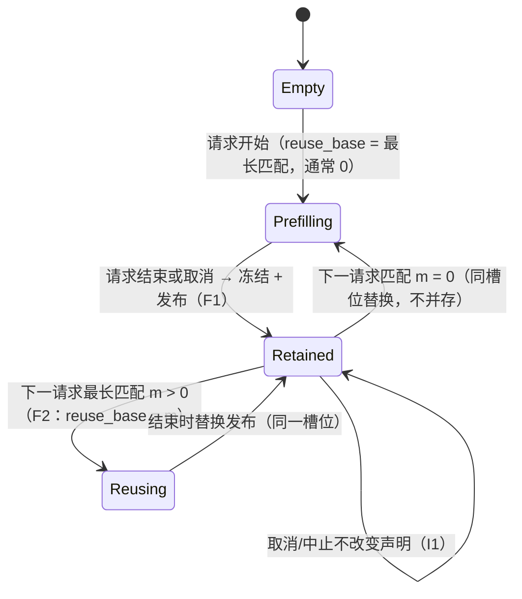

# KV 流式的上下文缓存：语义、已知缺陷与修复设计

**这份文件是什么**：把"流式 run 里跨请求复用上下文"当作一个**功能**做整体评估与设计，而不是逐次修 bug。
它记录功能应当是什么、现状错在哪、修什么、怎么验收、怎么回退。历史与逐次实测在
`bench/results/kv-stream/ledger.md`；缺陷的原始证据在 `bench/results/kv-stream/layout-rename-defect.md`。

**当前状态**：四个崩溃已用"宽容化"补丁止血，但**其中一条补丁本身在破坏缓存收益**（见 §4.3），
所以现状**不能当作完成**。

---

## 1. 功能认知：缓存只影响速度，不影响接纳与结果

这是原版 ninfer 的语义，也是流式必须继承的语义：

1. 有可复用前缀 → 快；没有 → 从头算。
2. 缓存里的东西作废了 → 丢掉，继续算。
3. **绝不会因为缓存状态报错、拒绝请求或崩溃。**
4. **输出与缓存无关**：命中与否必须逐位相同。

### 1.1 代价模型（决定"假未命中"有多贵）

prefill 实测约 1.5 k tok/s（183 K 流式 1476、251 K 1281），命中时 TTFT 是**百毫秒级**：

| 上下文 | 全量 prefill（估） | 命中 TTFT |
|---|---:|---:|
| 16 k | ≈ 11 s | ~0.1 s |
| 37 k | ≈ 25 s | ~0.1 s |
| 190 k | ≈ 2 min | ~0.1 s |

**结论**：判据不是"能不能容错"，而是"**能复用的必须复用**"。任何"有疑问就重算"的设计等于删掉缓存。

### 1.2 "命中"的正确定义

命中的价值是**最长匹配前缀**，不是"与上次的端点完全一致"：

- 请求的前 N 个 token 与某条已发布上下文一致 ⇒ 复用 N 个 token，剩下的重算；
- 发布新上下文时**替换**旧条目（同一槽位），不并存、不静默丢弃；
- 端点（endpoint = prompt + 已生成 − 1）只是"上次停在哪"，**不是**可复用的判据。

现状实现把 `reuse_base` 取成**端点前沿**，并要求 prompt 以该前沿为前缀
（`src/models/qwen3_5/program/planning/request_plan.cpp` 的 `inspect_lane`，`ReusePath::PrivateEndpoint`
分支），于是"同一个 prompt 再发一次"（少了上次生成的尾巴）被判为不可复用 ⇒ 整段重算。§4.1 有实测。

---

## 2. 责任边界：谁能回答"上下文现在有多深"

现状**同一条事实存了四份**，且没有一份是权威：

| 存放处 | 含义 |
|---|---|
| `address.committed_frontier` | 地址声称的已提交前沿 |
| `address.checkpoint_frontier` | 检查点声称的前沿 |
| `sequence.text_kv_valid` | 序列声称的 KV 有效深度 |
| `StreamedKVSpace::active_` | **空间实际持有的深度** |

任何"使用前"的判定若取自前三者，就可能与第四者不一致。四个崩溃全部由此而来（§3）。

**设计规则**：`StreamedKVSpace` 是唯一权威；其余三处都是它的**派生值**，在使用那一刻取值，
并且**只能比它短，不能比它长**。

---

## 3. 已知缺陷（四次崩溃，一次分类）

| # | 用户可见现象 | 触发 | 根因 |
|---|---|---|---|
| 11 | `KV activation reservation is stale` → serve **进程 abort** | 第二段对话进入 | 保留的上下文按**租约**占住唯一私有槽，新请求要么放不下，要么用已作废的激活 |
| 12 | `context cache exhausted: an idle Engine found no placement`（429） | 同上，1 个私有槽 | 规划器无法建立计划（`no materialization plan`），引擎在无活跃 lane 时报耗尽 |
| 13 | `streamed KV frontier is beyond the space's context` → worker crash → `FATAL engine` | 无取消，长会话后继续 | 规划期不校验"空间还装得下吗"，prefill 才抛 |
| 14 | 同上 | **取消一个请求之后** | 取消 → `deactivate` → 没有端点 → `reset()`，空间归零；目录条目仍在 ⇒ 下一次复用指向已不存在的页 |

**一句话根因**：**某处声称有 N 个 token 的 KV，空间实际只有 M < N，而"用之前"没有任何一层以空间为准再问一次。**

补充：`destructive_truncate` / `destructive_truncate_inactive` 的流式分支也会把
`address.committed_frontier` 直接转给 `enter_request`（`kv_store.h:1785/1866`），是同一族的另一个入口。

---

## 4. 现状的四条补丁及其问题（必须知道，避免重复）

### 4.1 已合入的补丁

| 位置 | 做什么 |
|---|---|
| `resource_manager.h` `drop_continuations_the_head_cannot_use` + `engine_core.h` `drop_unusable_context` | 放置失败且无活跃 lane 时，丢掉"队头不能完整复用"的已发布上下文，然后重做整次放置 |
| `request_plan.cpp` `inspect_lane` | 复用前沿若 `!stream_can_serve(base)` ⇒ 无候选（走冷） |
| `kv_store.h` 两处截断 | 按空间实际深度钳位 |
| `kv_stream_space.h` `stream_can_serve` | 给上面三处提供"空间能不能服务"的查询 |

### 4.2 两条硬约束（踩过的坑）

- **`ResourceManager::inspect` 必须保持只读**。第一版把驱逐放进 `inspect` 里，被
  `ninfer_resource_manager_test` 的 `retained source protection` 断言抓住（"retained private source edge is stale"）。
  正确位置是放置循环里、两次检查之间（每请求最多一次）。
- **一次放置内部重试会留下悬空句柄**：先丢条目再用同一批候选重规划 ⇒ `pressure planning candidate is stale`。
  必须**重做整次放置**（新的 inspection）。

### 4.3 这些补丁的问题：驱逐会制造"假未命中"

"不能完整复用就丢掉"对缓存是**反向**的：把一次**部分命中**变成**未命中**，并毁掉后续请求本可使用的上下文。

serve 实测（16 k prompt）：`r1 reuse=0`（首次，正常），`r2 reuse=0`（**同一个 prompt**，假未命中 ⇒ 多花 ≈11 s）。
r4 则表现为"规划到 `reuse=2 base=16147` 但 `space_pages=0`"——空间被 r3 的取消清零，条目却还在。

**所以 §4.1 的补丁只能当护栏，不能当设计。**

---

## 5. 修复设计：三条不变量 + 三个机制

### 5.1 不变量

- **I1｜取消不等于作废**：请求被取消/中止时，只要页面仍一致，就**保留**（像正常结束一样冻结并发布），
  或**在同一时刻**让目录条目失效。**不允许只清一边。**
- **I2｜命中按最长前缀，发布即替换**：`reuse_base = 最长匹配前缀`（≤ 端点）；新上下文发布进**被替换条目的
  同一槽位**；不并存、不丢弃。
- **I3｜声明在使用时校验，且只能变短**：任何前沿在使用那一刻向空间取；空间答"只能给 M"，就按 M 复用
  （M 仍是合法前缀）；只有 M = 0 才全量重算。

### 5.2 机制

**F1｜取消不清空（I1）**

- 位置：`KVStore::deactivate` 的流式分支（`if (stream_space_->retained()) retain(); else reset();`），
  以及 `ProgramImpl` 的 abort/salvage 路径（`transactions/commit.cpp`：`result.salvaged` →
  `publish_salvaged_continuation`，`finish()` 已有该分支）。
- 目标：被取消的请求要么**冻结并发布**（可被后续复用），要么**同时**清空条目与空间。优先前者（UX）。
- 注意：被取消的请求可能有**推测尾部**（未验证的草稿 token），发布前必须截到已提交前沿。

**F2｜最长前缀命中 + 替换发布（I2）**

- 位置：`request_plan.cpp` 的 `inspect_lane`（把 `reuse_base` 从"端点前沿"改为"匹配长度（≤端点）"），
  以及 `transactions/capture.cpp` + `resource_manager.h` 的捕获/发布路径。
- 关键事实：现有"替换"通道只为**长锚点**建立候选
  （`capture.cpp:87` 由 `sequence.long_anchors` 生成 `private_replacement_candidates`），而流式形状
  `max_long_anchors_per_continuation = 0` ⇒ 候选永远为空 ⇒ **替换通道对流式不存在**。
- 因此 F2 的实质：让"**本次请求要替换的那条目录条目**"成为替换候选（复用现有
  `inspect_capture(..., private_replacement, ...)` 与 `CaptureScenario.publication_slot` 机制，不另造一套）。
- 收益：把假未命中变成命中（16 k 场景 ≈11 s → ~0.1 s），并**顺带删掉 §4.1 的驱逐**（不再需要"丢"）。

**F3｜使用时刻钳位（I3）**

- 位置：`prefill.cpp` 的 `enter_request(sequence.text_kv_valid)` 调用前，以及 `kv_store.h` 的两处截断。
- 规则：`served = min(claimed, space_servable)`；`served == 0` 才走冷启动。**永不抛出。**
- F3 只是护栏：F1+F2 正确时它不应触发（用断言/日志验证触发次数为 0）。

### 5.3 空间生命周期（目标状态）

---

## 6. 验收矩阵（缺一不可）

| 检查 | 判据 |
|---|---|
| 逐位等价 | `check --suite equiv` 4/4（8 K/100 K/183 K × resident/streamed），ids 与 logprobs 逐位 |
| C13 跨请求复用 | `reused == retained_frontier`，且与冷跑逐位 |
| C14 几何不变 | 两种池形状 ⇒ ids 与 logprobs 逐位相同 |
| C15 保留即缓存 | 任意下一请求都被接纳（不同前缀/部分前缀/更长/回归） |
| **C17 假未命中（新增）** | **同一个 prompt 连续两次** ⇒ 第二次 `reused > 0`（现在为 0）；只共享开头的请求 ⇒ `reused == 匹配长度` |
| **C18 取消不作废（新增）** | 长会话 → 续聊 → **客户端断开** → 再续聊：后续请求 `reused > 0`、进程存活、无 `worker crash` |
| serve 端到端 | `A → B → A`（两会话）与 `A → A2`（同会话）全 200；日志 `worker crash`/`terminate`/`FATAL engine` = 0 |
| 性能不退化 | 251 K `round_ms_median` ≤ 41.4 ms +1%、`upload_bytes` 不显著变化（证明不是靠少搬变快） |
| 冲突检查 | 触发 `[stream] request starts: reuse=… space_pages=…` 中 `space_pages < base` 的次数为 0（F3 未触发） |

诊断开关：`NINFER_STREAM_DEBUG=1`（每次请求的 `reuse/base/valid/space_pages`）、
`NINFER_ADMISSION_DEBUG=1`（放置被哪道闸门挡住）、`NINFER_STREAM_VERIFY=1`（环→表→attention 字节 oracle）。

---

## 7. 实施顺序与回退

| 步 | 内容 | 出口判据 | 回退 |
|---|---|---|---|
| 1 | **F1** 取消不再清空（保留或同生共死） | C18 + serve 取消序列绿 | 单提交可 revert |
| 2 | **F2** 最长前缀命中 + 替换发布 | C17 + equiv + C13/C14/C15 绿，251 K 不退化 | 单提交可 revert；`--no-prefix-reuse` 是逃生口 |
| 3 | 删除 §4.1 的"丢弃"逻辑，保留 `stream_can_serve` 作为断言 | 同上全绿；`[admission] dropping…` 不再出现 | 单提交 |
| 4 | **F3** 钳位（若第 3 步后仍需） | 触发次数 0 | 单提交 |
| 5 | 文档收口（verification C17/C18、measurements、handoff） | 链接与数字一致 | — |

**顺序不可颠倒**：F1 之前做 F2，会在"取消清空"的空窗里继续产生 stale 声明。

---

## 8. 明确不做（防止走偏）

- **不重写、不硬分叉**：难点是簿记一致性，不是架构；重写会把这些接缝再造一遍。
- **不把"冷启动重算"当主要修复**：它只用于 `served == 0`。把它当默认，等于删掉缓存（§1.1 的代价）。
- **不在只读路径（`ResourceManager::inspect`）里改状态**；驱逐/替换必须发生在放置循环里。
- **不在一次放置内部重试**（会留悬空句柄）；要么重做整次放置，要么在捕获路径里替换。
- **不并存多条流式 continuation**：流式空间只有一个活世系；并存只产生歧义，不产生能力。

---

## 9. 未决问题（需要所有者决定）

1. **是否允许多条私有 continuation**（多会话同时留住上下文）：这是 host RAM + 地址空间的容量问题，
   与语义无关。现状 = 1。
2. **被取消请求的上下文是否发布**（F1 的两种处理）：发布 = 续聊命中；不发布 = 更保守。本文推荐发布。
3. **`--no-prefix-reuse` 是否保留为产品开关**：作为逃生口建议保留。
