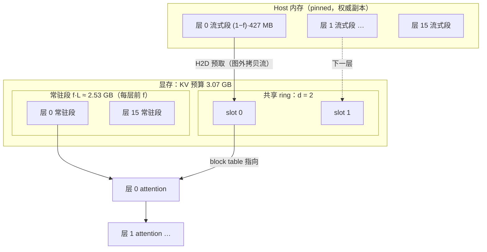
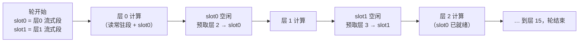
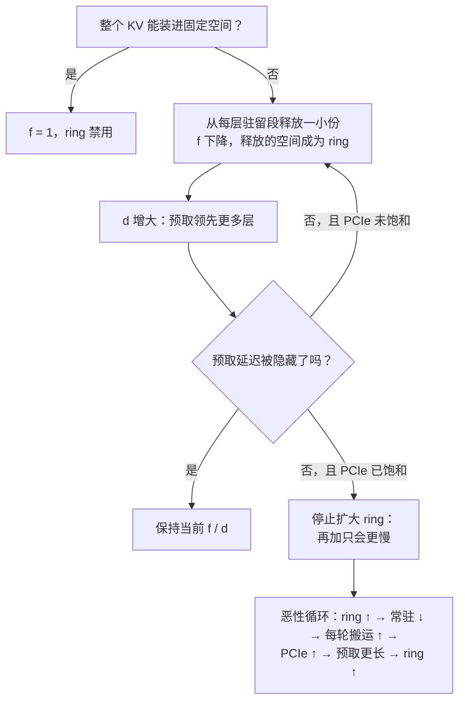

# 自适应 KV 流式

目标、机制、预算、决策点与验收。外部资料（参考文章与 CUDA Graph 说明）在
[adaptive-kv-streaming-inputs](adaptive-kv-streaming-inputs.md)，它们是设计输入，不是本仓库的状态。

## 1 目标

在 RTX 4080 SUPER（16 376 MiB，sm_89，PCIe 4.0 x16）上，让 Qwen3.8-27B Dense 跑满
**262 144 原生上下文**，且：

- **质量下限 `rk8v4`**；`rk4v4` 及以下在真实任务上幻觉与记忆不可接受（所有者实测）。
  流式稳定后倾向 `int8`。
- decode 可用（见 §4 的真实上界），结果与全驻留**逐 token 一致**。
- 默认关闭；`--kv-stream` 打开。关闭时行为与今天逐字节一致。
- 只加流式，不删任何模型族。

## 2 现状（本机实测，2026-11-08）

* 权重上卡 11.6 GiB；IQ3_S 文本。
* 权重之后可用于运行时容量的显存：**4 757 913 600 B（4.43 GiB）**；带 `--spec mtp
  --draft-tokens 3` 时 **4 032 299 008 B（3.76 GiB）**。
* 固定开销实测：无草稿器约 0.44 GB，带 MTP3 约 0.96 GB；**带 MTP3 的 KV 预算约 3.07 GB**。

262 144 的启动探针（`--vision` 关）：

| `--kv-dtype` | 每 token | 262 144 需要 | 结果 |
|---|---:|---:|---|
| `bf16` | 65 536 B | 17.62 GB | 失败 |
| `int8` | 33 792 B | 9.90 GB | 失败 |
| `rk8v4` | 26 112 B | 7.33 GB | 失败 |
| `rk4v4` | 17 920 B | 5.18 GB | 失败（差 0.42 GB） |
| `rk2v4-e8` | 13 824 B | 3.38 GB | 成功 |

阶梯（`rk8v4` + MTP3 + greedy，128 token 生成）：

| 上下文 | prefill | decode | MTP 接受长度 | 峰值显存 |
|---|---:|---:|---:|---:|
| 8 192 | 2.37k tok/s | 114.3 tok/s | 2.76 | 12 672 MiB |
| 32 768 | 2.28k | 115.0 | 2.89 | 13 322 MiB |
| 65 536 | 2.11k | 117.6 | 3.10 | 14 188 MiB |
| 120 000 | 1.86k | 109.1 | 3.10 | 15 632 MiB |

32K 同 prompt 的 KV 对照：`bf16` 121.8 / `int8` 116.6 / `rk4v4` 115.1 / `rk2v4-e8` 122.2 tok/s。

模型几何（artifact 核实）：64 层，其中 **16 层 full attention**（3、7、…、63）、48 层线性注意力
（KV 不随上下文增长），4 个 KV 头、head_dim 256。所以流式只涉及 16 层。

**一层的 KV 大小**（262 144）：

| KV | 每层 | 16 层合计 |
|---|---:|---:|
| `rk8v4` | 427 MB | 6.85 GB |
| `int8` | 554 MB | 8.86 GB |
| `rk4v4` | 294 MB | 4.70 GB |

## 3 机制

### 3.1 原理：为什么可以流式，为什么是 ring

整条链是从四个观察推出来的（原文的推理链）：

1. **KV 只有一部分会涨。** Qwen3.5/3.8 的 64 层里只有 16 层是 full attention（KV 随上下文线性增长），
   另外 48 层是线性注意力（状态大小恒定）。要动的是那 16 层。
2. **层是顺序执行的**，后一层必须等前一层。
3. **一层的 KV 只在自己那层计算时被读写**，这层算完到下个 token 之前都不会再碰。
   → 所以“这层算完就可以把它的 KV 从显存拿掉”是安全的。
4. **但从 host 拷回来要时间**，等 GPU 要用了才拷就会停等。
   → 所以必须**提前预取**，而且要有一个可重复使用的小工作集。

这四条直接推出两种可行结构：层轮转的 ring，或“每层留一部分、剩下的共享一个 ring”。
单看容量，两者等价；区别在显存开销（见 3.3 的账）。

### 3.2 已经具备的物理基础

- KV 以页存储，attention 通过 **block table（显存里的数据）** 寻址，页号不是 graph key
  （`paged-kv-cache`、`decode_graph`）。因此“换页”不需要重捕获图。
- 每层有独立 plane（`state/decoder_state.cpp` 的 `plane_index()`），但**全部层共用同一张
  block table 行**：页组 `g` 在每层是同一个物理页号。这是流式的第一个结构性约束。
- `ops/kv_stream` 已有可捕获的“host 块 → 设备 slot”拷贝：位置来自设备 I32、网格固定，
  `kv_stream_resolve` 在 GPU 内认领并搬运。
- 捕获体内等待外部事件的先例：`program/structured_round.cpp:136-141` 用
  `cudaStreamWaitEvent(stream, e, cudaEventWaitExternal)`。

### 3.3 流式形状：每层按公平份额切分

**不是“某些层全驻留、某些层整层流式”。** 参考文章的做法是：把每层 full-attention 的 KV
切成两段——**常驻段**留在设备，**流式段**留在 host，每轮按需拷回；切分比例 `f` 对**所有**
full-attention 层一致（公平份额）。所以 262 144 × `rk8v4` 时，若 `f = 0.37`，每层有
158 MB 常驻、269 MB 每轮流一次。

ring 只承载“流式段”，以页组为单位滚动：层 `l` 的流式段算完，它的 ring 空间才能被层
`l+d` 覆盖（`d` = ring 深度 = 预取领先几层）。由此得到两条顺序保证：覆盖 `l+d` 之前 `l`
已算完；算 `l+d` 之前拷贝已完成。MVP 用**单流**（先拷后算），第二步再把拷贝放到图外的
第二条流、用外部事件让图内每层等它。

切分比例随上下文长度**自适应**，规则照参考文章 §自适应重分区：

1. 全驻留（`f = 1`，ring 禁用）；
2. 装不下时，从**每层**各释放一小份，汇成 ring（`f` 下降一个档）；
3. 只有“扩 ring 仍能隐藏拷贝延迟”时才继续扩；
4. PCIe 已饱和就停，否则是“更大 ring → 更少常驻 → 更多搬运 → 更慢”的恶性循环。

**一条必须记住的不变量**：每轮搬运字节 = `(1 − f) × 总 KV`，**与切分形状无关**。
把常驻量摊到每层（而不是整层驻留），改变的是 ring 的开销和调度粒度，不是每轮的总搬运量。
这一点在 §4 的算式里直接体现。

### 3.4 原理图

**（1）结构与数据流**：host 是权威副本；每层只在显存里留一个 `f` 比例的常驻段；
所有流式层共用一个深度为 `d` 的 ring；attention 通过 block table 查到“这段现在在哪个 slot”。

**（2）一轮内的 ring 轮转（d = 2，16 个 full-attention 层）**：层 `l` 算完，它的 slot 才能被
层 `l+d` 覆盖。这就是两条顺序保证的来源。

**（3）自适应调参（带刹车）**：这是原文最关键的一段——扩大 ring 有恶性循环，必须能停。

## 4 上界的真实算法（关键）

decode 的每轮代价**按轮计，不按 token 计**：一轮验证 K+1 个 token 只搬一次 KV。记总 KV 为 `L`，
每层常驻比例为 `f`，ring 深度 `d`（单位为“一层的流式段”），则

    常驻 = f·L          ring = d·(1 − f)·L / 16
    每轮搬运 = (1 − f)·L
    每轮时间 ≥ 每轮搬运 ÷ 有效带宽
    tok/s ≈ 每轮接受长度 ÷ 每轮时间

显存预算 `B` 决定 `f` 与 `d` 的取舍：`f·L + d·(1 − f)·L/16 = B`。

**重叠能省下什么。** 一轮里 GPU 要做的两件事在时间上是可并行的：PCIe 拷贝（DMA）
与计算（读权重 + attention + HBM）。120 K 实测 109.1 tok/s、3.1 tok/轮 → 每轮约 28 ms，
而 262 K 每轮拷贝约 172 ms。于是：

    单流（先拷后算）  = 172 + 28 ≈ 200 ms → 3.1/0.20 ≈ 15.5 tok/s
    拷贝与计算重叠    = max(172, 28) = 172 ms → ≈ 18 tok/s

重叠省下 ~14%，而不是把拷贝藏起来（拷贝本身就是下限）。**真正决定 tok/s 的是每轮搬运的字节数**，
所以“每层切分”的收益体现在**省下 ring 显存、抬高 `f`、让每轮少搬**，而不是重叠。

按 KV 预算 `B` = 3.07 GB（带 MTP3，`--vision` 关）、有效带宽 25 GB/s（待实测：PCIe 4.0 x16
空闲 2.5 GT/s、加载时 16.0 GT/s）算：

| KV | 深度 `d` | `f` | 常驻 | 每轮搬运 | 拷贝 | **单流** | **重叠后** |
|---|---:|---:|---:|---:|---:|---:|---:|
| `rk8v4` | 2 | 0.37 | 2.53 GB | 4.30 GB | 172 ms | **15.5 tok/s** | **18 tok/s** |
| `rk8v4` | 3 | 0.32 | 2.20 GB | 4.63 GB | 185 ms | 14.5 | 16.8 |
| `rk8v4` | 1 | 0.41 | 2.82 GB | 4.02 GB | 161 ms | 16.3 | 19.3 |
| `int8` | 2 | 0.25 | 2.24 GB | 6.62 GB | 265 ms | 10.5 | 11.7 |

（每轮计算 28 ms 是从 120 K 实测反推的；它们都是**上界**，未计同步与 attention 在 262 K 的额外开销。
MTP 接受长度在 262 K 也可能低于 3.1。参考文章 PCIe 5.0、无投机解码下 253 K 约 13 tok/s，同量级。）

对照：如果按整层驻留（ring 深度 2 就要 2×427 MB = 854 MB），`f` 只能到 0.32，每轮 4.70 GB，
单流约 14.5 tok/s。**每层切分把 ring 开销从 854 MB 压到 ~538 MB**（`f` 从 0.32 抬到 0.37），
换来 ~7%；再细到页组（ring ~256 MB）还能再抬 ~2 个百分点。收益真实但不大，
因为 262 K 的 `L` 是预算的 2.2 倍，切分形状改不了这个比例。

**推论：70/30 在 262 144 上做不到。** 取 `f = 0.7`、`d = 2`，
`0.7·L + 2·0.3·L/16 = 0.7375·L = 3.07 GB` → `L = 4.16 GB` → 约 **159 400 token**（`rk8v4`）。
也就是说：**≤159 K 可以按 70/30 跑，再往上常驻比例必须一路降到 37%**。这也是“上下文越长
tok/s 越低”的真实原因——不是计算变慢，是每轮要多搬。

## 5 决策点（实现前定，写进本文件）

| 编号 | 问题 | 备选 | 倾向 |
|---|---|---|---|
| D1 | 页命名空间：流式层放哪 | A 新建 streamed pool（自己的 execution table 与容量曲线项）；B 给 Main pool 加 per-layer 表 | 先 A：局部、可回退 |
| D2 | host 权威副本归谁 | A 扩 `HostKVPageLayout`/`HostKVArena`；B Program 自建 pinned store | A，复用既有页几何 |
| D3 | 切分粒度 | A 整层（某些层全驻留）；B 每层按公平份额切分，ring 只承载流式段 | **B**：ring 从 854 MB 降到 ~256 MB，`f` 抬高约 5 个百分点 |
| D4 | ring 深度 | 固定 2（MVP）→ 自适应 | 固定 2 起步 |
| D5 | 与 prefix cache 的关系 | Legacy（默认）先支持；Hybrid 后接 | Legacy 先行 |

D3 的账（§4 已算）：整层驻留时 ring 深度 2 就要 854 MB，只留下 `f = 0.32`；每层按份额切分时
ring 只需 2 × 269 MB ≈ 538 MB（`f = 0.37`），多出的常驻量直接换成每轮少搬 0.4 GB。
更细的页组粒度还能把 ring 压到 ~256 MB，但排序与依赖变复杂，MVP 先用“整页组 × 每层份额”。

## 6 不变量

1. 拷贝期间源与目标都被 pin；目标在拷贝完成且 epoch/coverage 校验通过前不进入 block table。
2. 一次 GPU 执行单元内，被选中行的 block table 不变、page payload 不搬迁。
3. 同一 `--kv-dtype` 下，streaming on/off 的 greedy token ID 与 logprobs 一致。
4. 失败（OOM、slot 不足、拷贝失败）回到完整 inactive 终态，不留半改写的映射。
5. 默认关闭；关闭路径与今天逐字节一致。
6. 每轮结构化日志：常驻字节、流式字节、H2D 次数与耗时、等待时间、调节原因。

## 7 验收

1. `rk8v4` 的 262 144 能启动并稳定 decode；`int8` 同（可能是更慢的一档）。
2. 同格式 on/off 逐 token 一致（8K、32K 两组指纹）。
3. 全驻留路径不回退：120K `rk8v4` 109.1 tok/s 为标尺。
4. 关掉 `--kv-stream` 即今天的行为。
5. 报告真实数字，并解释比 §4 上界差多少（同步、计算、接受的损失）。

## 8 里程碑

| 阶段 | 内容 | 完成条件 |
|---|---|---|
| M0 | 核实 §3.2 的四条前提（block table 稳定性、共用行、外部事件、page 发布） | 结论写进本文件 |
| M1 | host 权威 KV + 固定划分 + 固定 ring + 单流拷贝 | 262K `rk8v4` 跑通 |
| M2 | 一致性 | on/off 逐 token 一致 |
| M3 | 图外拷贝流 + 图内外部事件 | 每轮等待时间显著下降 |
| M4 | 自适应划分 | 全驻留阈值与停止扩 ring 的条件可复现 |
| M5 | `int8` | 262K `int8` 跑通并记录 |
