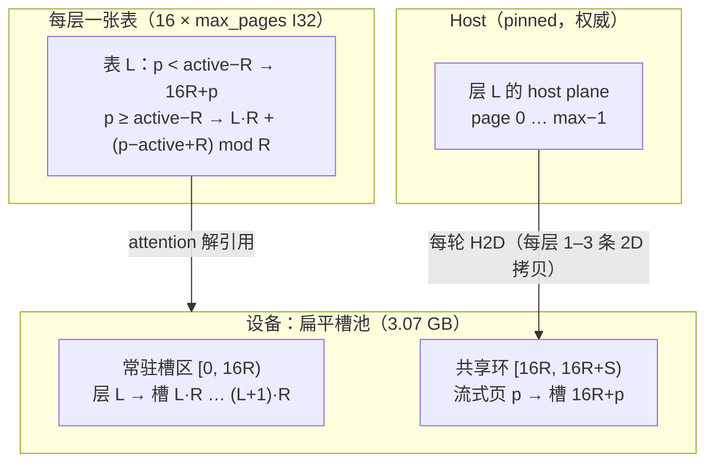
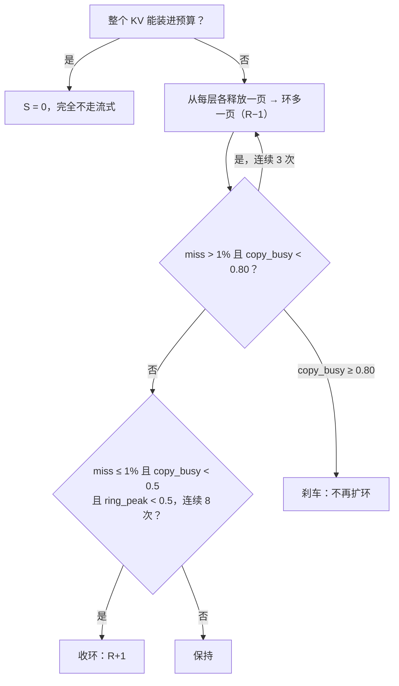

# 自适应 KV 流式：原型设计

本文件是**施工前的完整设计**：目标、参考实现解剖、NInfer 现状核实、数据模型、每轮执行
序列、容量算术、自适应控制器、失败语义、指标、里程碑。实现必须按本文件的合同走；任何偏离
先改本文件。

外部的两篇资料在 [adaptive-kv-streaming-inputs](adaptive-kv-streaming-inputs.md)（参考文章与
CUDA Graph 说明）。参考实现是作者在 llama.cpp 上的 61 个提交、10 519 行改动。

---

## 0 结论摘要

1. 262 144 在 16 GB 上**不可能靠提高 KV 精度装下**：`rk8v4` 要 7.33 GB，`int8` 要 9.90 GB，
   而带 MTP3 时 KV 预算只有 **3.07 GB**。
2. 可行的做法是**页粒度**的“常驻 + 环”：host 是权威副本，设备池 = 每层若干常驻页 + 一个
   **跨层共享**的槽位环，每轮把每层的流式段拷回槽位。
3. 每轮搬运字节 = `(1 − f) × 总 KV`，**与切分形状无关**；形状只决定环的显存开销。
4. NInfer 有一个参考实现没有的优势：**KV 通过 block table 间接寻址**。参考实现因此必须做
   “分段注意力 + 偏 softmax 合并”，而且在流式生效时**关掉 CUDA Graph**；NInfer 可以只改表，
   两个都不需要。
5. 但今天的设备池是**每层一个 plane**，页索引只能指向本层内部，环就无法跨层复用。由此可得一个
   硬结果：`16(R + S) ≥ 16P`，**在 per-layer plane 的池里，页粒度流式在数学上不可能省内存**。
   所以第一个结构性决定是新建一个**扁平槽池**（一个槽 = 一层一页）+ **每层一张表**（D1，§4.1）。
6. 262 144 时的真实上界：MVP（单流、无重叠）约 **15.3 tok/s**；加分段流水后约 **18.9 tok/s**
   （`rk8v4` + MTP3，已用实测 25.7 GB/s 重算）。`int8` 约 10.6 / 12.6。见 §5。

---

## 0.1 可行性判定（施工前必须知道）

**结论：能实现，无决定性硬件/API 阻碍。** 逐项依据：

| 检查项 | 结论 | 依据 |
|---|---|---|
| PCIe 4.0 x16 带宽 | **实测 25.7 GB/s H2D / 25.4 D2H**，且拷贝引擎与计算**完全独立** | 512 MiB × 30 次，2D 同速；并发 spin kernel 时 20.803 ms vs 串行 20.832 ms |
| 拷贝与计算并行 | 可以 | 拷贝引擎独立于 SM；`copy_from_host` 走 `cudaMemcpy2DAsync` |
| pinned host | 已有 | `HostKVArena` / `HostKVExtentStore` 就是 pinned 页分配器 |
| 异步 H2D + 事件 | 已有 | `PhysicalKVPagePool::copy_from_host(span)`；`hybrid_cache` 的 `submit_restore/land_restore` |
| 图内等外部事件 | 有先例 | `program/structured_round.cpp:136` 的 `cudaEventWaitExternal` |
| 图内改页映射 | **支持，且是 NInfer 的优势** | attention 吃 `(pages, block table)`，表是显存数据，不是图参数 |

**必须改的一处架构**：今天 per-(layer,rank,kind) plane，页索引指不出本层 → `16(R+S) ≥ 16P`，
流式不可能省内存。换扁平槽池 + 每层表（§4.1），**内核签名与数学不变**（已核实：
`kv_cache_append.cpp:52-56` 用 `k_pages` 的 4D 形状 + 基址 + 物理页号；
`text.cpp:890` 的 attention 显式收 `table`）。

**3 条硬约束**：M1 单序列（环是共享资源，N 序列要 N 倍环）；M1 拒绝 Hybrid prefix cache 与
Legacy checkpoint（设备页不再代表完整 KV）；M1 不支持 TP/流水（`page_stride/page_residue`）。

**预算修正（M0-4 推翻旧假设）**：MTP 的池与主池**同尺寸**（`mtp_physical_pages = physical_pages +
1`，`mtp_layers = 1`），262 144 `rk8v4` → **428 MB**；而 3.07 GB 的预算来自“带 MTP3 的实测运行时
容量”，**已包含这 428 MB** → 流式池只有 **2.64 GB（25 300 页）**。所有容量与上界已按此重算。

**2 个待核实（会影响做法，不会变成做不到）**：块表在重放间的地址稳定性；
`cudaEventWaitExternal` 重播语义。退路：失图改 eager（参考实现就这样）或
`cudaGraphExecKernelNodeSetParams`。

---

## 1 目标与非目标

**目标**：`--kv-stream` 打开后，Qwen3.8-27B Dense 在 RTX 4080 SUPER 上以 `rk8v4`（最低档）
或 `int8` 跑满 262 144 原生上下文；同一格式下 tok/s 与 logprobs 与全驻留逐 token 一致；
默认关闭；关闭时零行为变化。

**非目标**：删模型族/删架构；UVM 路线（参考文章已证明页面抖动会毁掉 decode）；降低 KV 质量换
容量；预填充阶段的分块流式（本设计只管 decode 的按层流式，预填充走既有 chunk 路径，页在
预填充时正常写入 host 与设备）。

---

## 2 参考实现解剖（llama.cpp fork）

### 2.1 数据放置

- **权威副本在 pinned host**：KV 文本张量分配在自定义 CPU buffer type 上；设备侧只有一个
  **有界池**（`--kv-stream-stage-mib`），池内分两段：`scratch`（传输槽）与 `resident`（常驻页）。
- **页 = 256 token**。池分配：`resident_pages_per_layer × layer_count + ring_slots` 个页。
  `llama_kv_stream_pool_layout_make()` 算常驻页数，`llama_kv_stream_plan_make()` 把 region
  列表（每层每页一个 region，带 `residency_priority`、`pinned`）切成 resident / streamed 两组。
- 常驻的是每层**最前面**若干页（`region.token_begin` 从小到大），流式段是每层的尾部。
- 写入：`ggml_set_rows` 要么经 **mirror** 映射直接写进常驻页（`online_write` 类型），要么落
  host 再重传；`mark_dirty_rows` 记录被写的行。

### 2.2 调度与同步

- 每次图执行前 `ggml_cuda_kv_stream_prepare_graph()` 扫节点：`graph_begin` → 每个
  flash-attn 节点 `graph_add_attention()`（登记“这一层这一页要读”）→ `graph_finalize()`。
- 执行到某层的 attention 时，把**未来层**的页顺着空闲槽投递到一条**独立的非阻塞拷贝流**：
  每槽一对 `ready` / `consumed` 事件 + 一份设备侧 `ready_flags`；消费者等 `ready`；
  过期/完成的槽等 `consumed` 才能被复用。
- 记 `deadline_samples` / `deadline_misses`（页是否在需要前到达）、`copy_engine_busy_ratio`、
  `ring_peak_occupancy`、`hand_to_device_bytes` 等。
- 注意力有两种形态：**整段**（拷齐再算）与**分段流水**（拷一段算一段，用偏 softmax 按
  `max_logit` 重新缩放合并；`llama-kv-stream-softmax`）。用在线调参器（`kv_stream_span_tuner`，
  16 次采样、0.5% 最小增益、布局变化即复位）选更快的那个。

### 2.3 自适应控制器（`llama_kv_stream_partition_adapt`）

- 目标：`ring ≥ 1.10 × 一层要流的页数`（`target_ring_working_set_ratio`）。
- 扩环（每层降级一页）：`miss_ratio > 1%` **且** `copy_busy < 80%`，连续 3 次评估。
- 收环（每层升级一页）：`miss_ratio ≤ 1%` **且** `copy_busy < 50%` **且** `ring_peak < 50%`，
  连续 8 次。
- 两次重分区之间冷却 64 次评估；进入 decode 布局时直接跳到目标；环超配则退回目标。
- `extent`（每层活跃页数）按 `live + reserve` 页对齐增长，收缩有滞后。

### 2.4 三个硬限制（必须知道）

1. **流式生效时会关闭 CUDA Graph**：`ggml_cuda_graph_set_enabled` 里，只要有任一 attention
   读到非常驻页，`use_cuda_graph = false`。全部常驻时才保留图。
2. **只支持目标上下文**：MTP/草稿上下文不允许流式（配置校验直接报错）。
3. 只支持 Qwen3.5、单序列、Flash Attention、GPU KV offload、`stage ≥ 一页`。

### 2.5 可以借 / 不可以照搬

| 借 | 不照搬 |
|---|---|
| 页粒度 + 公平份额（每层降一页即扩一个环页） | 关闭 CUDA Graph（NInfer 有 block table，不需要） |
| 三指标反馈（miss / copy busy / ring peak）+ hysteresis + 冷却 | 分段注意力 + 偏 softmax 合并（NInfer 改表即可，MVP 不需要） |
| 每槽 `ready`/`consumed` 事件对 + 设备侧 flag | 256-token 页（NInfer 是 64） |
| “mutable tail 不可预取” | 把 MTP 上下文排除在外（NInfer 的 MTP KV 单独算，页数很小，可一并处理） |

---

## 3 NInfer 现状（已核实的代码事实）

| # | 事实 | 位置 |
|---|---|---|
| 1 | 页 = **64 token** | `src/core/paged_kv_cache.h:20` |
| 2 | 每 (layer, rank, kind) 一个 plane（K/V/scale 分开） | `state/decoder_state.cpp:200-210` |
| 3 | **块表每序列一行，所有层共用**（同一页在每层同号） | `state/decoder_state.cpp:223`、`paged-kv-cache.md` |
| 4 | 批量视图有 `block_tables` 矩阵形式 | `src/core/paged_kv_cache.h:44` |
| 4b | 地址公式 = 本层 plane 基址 + `local_page × page_bytes`，**页索引不能指向别的层** | `src/ops/kernel/paged_kv_address.cuh:11-20` |
| 5 | 页搬运原语已存在：`copy_page`（D2D）、`copy_to_host`（D2H，按 span）、`copy_from_host`（H2D，按 span） | `src/core/paged_kv_cache.h:332-339` |
| 6 | host 页布局与分配已存在：`plan_host_kv_page_layout`、`HostKVArena`、`HostKVExtentStore` | `src/core/host_kv_arena.h:26-40`、`program/storage/host_kv_store.h` |
| 7 | `TransferWork` 只是代价模型（字节数/拷贝次数），不是执行器 | `src/core/transfer_work.h` |
| 8 | 图捕获/更新：`DecodeGraphDefinition::capture` + `DecodeGraphExecutable::update` | `src/core/decode_graph.h` |
| 9 | 图内等外部事件的先例：`cudaEventWaitExternal` | `program/structured_round.cpp:136-141` |
| 10 | 已有的流式 KV 前例：qwen4_exp 的稀疏层把 host 页当权威、设备池当工作集、`kv_stream_resolve` 在 GPU 内搬页并改表 | `src/models/qwen4_exp/executor.cpp:3444-3500` |
| 11 | 已有的异步 host↔device 往来引擎：hybrid prefix cache 的 `open_restore / restore_block / submit_restore / land_restore(consumer) / transfers_pending / drain` | `program/prefix/hybrid_cache.h:179-198` |
| 12 | `ops/kv_stream` 是可捕获的“页→槽”拷贝 + 表改写（网格固定、位置来自设备 I32） | `src/ops/kv_stream/SPEC.md` |
| 13 | 16 个 full-attention 层（3、7、…、63），4 个 KV 头，head_dim 256；另外 48 层线性注意力状态不随上下文增长 | artifact 实测 |
| 14 | 带 MTP3 的 KV 预算 **3.07 GB**；`rk8v4` 每层每页 **104 448 B**（64 token × 4 头 × 408 B） | 本机实测 + 几何 |

**由 3 推出的第一个结构性结论（D1）**：块表一行为全层共用，所以同一逻辑页在所有层必须落在
同一物理页。流式要“每层各自决定哪些页在环里”，就必须**每层一张表**。设备上多 16 张
`[max_pages] I32` 表（262 K 时 16 × 4096 × 4 B = 256 KB），可以放在一块缓冲里按层切行，
`PagedKVLayerView.block_table` 本来就是 Tensor，按行取即可——不需要改消费端合同。

---

## 4 设计

### 4.1 第一个结构性决定：必须有**扁平槽池**（不是每层 plane）

这里有一个必须先算清楚的算术。今天的设备池是**每（layer, rank, kind）一个 plane**
（`plane_index()`），attention 的地址是 `plane(layer) + page × page_bytes`（`paged_kv_address.cuh`）。
在这种布局下：页索引只能指向**本层 plane 内部**的位置，所以环必须嵌在每层的 plane 里，
而且**不能被别的层复用**。于是池容量 = `16 × (R + S) × B`，而流式又要求
`S ≥ P − R`，两者合起来：

```
16(R + S) ≥ 16(R + P − R) = 16P = 整个 KV
```

**结论：在 per-layer plane 的池里，页粒度的流式在数学上不可能省内存。**
这也是参考实现能成立、而直接照搬其思路到 NInfer 会失败的原因：llama.cpp 的 attention 直接
吃 K/V 指针，所以它的 ring 是一块跨层共用的平缓冲区。

所以本设计的第一个决定是：为 16 个 full-attention 层新建一个**扁平槽池**（D1），
一个槽 = 一层的一页；表把（层，逻辑页）映射到全局槽号；注意力内核的地址是
`pool + slot × page_bytes`。

- 它不改变任何内核：`PagedKVLayerView` 的 `k_pages` / `v_pages` 改为指向扁平池的 K / V plane，
  `block_table` 改为指向**本层**那张表（`PagedKVLayerView.block_table` 本来就是 Tensor）。
  `paged_kv_address.cuh` 的 `plane + local_page × page_bytes` 公式不用动。
- 这是“新建 streamed pool”而非改 Main pool：局部、可回退；不开 `--kv-stream` 时不分配。

### 4.2 数据模型

```
Host（pinned，权威）                  设备：扁平槽池（KV 预算 3.07 GB）
┌──────────────────────┐             ┌───────────────────────────────────┐
│ 每层一个 host plane  │   H2D       │ K / V / Kscale / Vscale 四个平面   │
│ page 0 … max-1       │ ────────►   │ 槽区：                             │
│ (rk8v4: 104 448 B/页) │   D2H       │  [0, 16R)       每层 R 个常驻槽      │
└──────────────────────┘             │  [16R, 16R+S)   共享环（S 个槽）     │
                                     └───────────────────────────────────┘
每层一张表 [max_pages] I32（16 张，共 256 KB @ 262 K）
```

- 页大小沿用 **64 token**（`kPagedKVPageSize`），不引入新页尺寸。
- 常驻的是每层**最新的 R 页**（窗口，见 4.6），流式段是更早的部分，环跨层共享。
- 槽一律以“一层一页”为单位；`page_bytes` 不变，所以 `ops/kv_stream` 的拷贝内核形状可复用。

### 4.3 地址映射与不变量

层 `L` 的逻辑页 `p`（`0 ≤ p < active`）→ 全局槽：

```
p < active − R    →  slot = 16R + p          （流式）
p ≥ active − R    →  slot = L·R + (p mod R)  （常驻窗口）
```

- 同时占用的槽数 = `16R + (active − R) ≤ 16R + S` ✓。
- **两半都只与页号有关，与 `active` 无关**。这一点是必须的：如果写成
  `(p − (active − R)) mod R`，同一个常驻页的槽会随上下文增长而变，每个页边界都要重写整层表。
  写成 `p mod R` 时，离窗的页与进入的页**正好接同一个槽**（两者页号差 R）。
- 因此每条表项一生只写**两次**：页出现时（指向窗口槽）、离窗时（指向环槽）。每个页边界
  每层 2 条 → 32 条 4 字节 H2D + 32 次事件，可忽略。
- 不变量：
  1. 一份槽在同一时刻只服务一层；层 `l` 的 `consumed[l]` 之后才允许层 `l+1` 覆写。
  2. 表里指向槽的项在槽内容就绪（`ready[l]`）之前不被读。
  3. 常驻窗口与 host 副本对同一页的字节必须一致（写入路径保证，见 4.6）。
  4. 表项的槽号永远 `< 16R + S`（越界即 bug，用 assert 卡住）。

### 4.4 每轮执行序列（MVP，单流）

```
for l in full_attention_layers:            # 16 层
    wait(consumed[prev])                   # 环上一次性只有一层在用
    copy  layer l 的流式段  host → ring    # 每 (层,plane) 一条 2D 拷贝
    recordReady(l)
    wait(ready(l))
    attention(l)                           # 读常驻窗口 + 环
    recordConsumed(l)
```

- **每轮拷贝次数 = 层数 × plane 数**（rk8v4 是 4 个 plane 但表里只有 K/V/scales 三类 → 3 条；
  bf16 是 2 条），与页数无关：一条 `cudaMemcpy2DAsync`（宽 = 一页一层一个 plane 的字节，
  高 = 流式页数）即可，因为 host 的页与环的槽在各自 plane 内都是连续的。
  262 K 时约 48–64 条拷贝命令/轮。
- 这条序列**没有重叠**：拷完才能算。这是 MVP 的代价，也是 16 tok/s 的来源（§5）。

### 4.5 容量算术

设每层页数 `P`（262 144 → 4096），每页每层 `B = 104 448 B`，**流式池预算 `K = 2.64 GB`**
（总 KV 预算 3.07 GB 减去 MTP 池 0.428 GB，M0-4）：

```
16·R + S ≤ K / B = 25 300 页        （常驻 16 层，环跨层共享）
S ≥ P − R                           （整层流式段同时在场）
⇒ 15·R ≤ K/B − P      ⇒ R ≤ (25 300 − 4096) / 15 = 1413
```

| 上下文 | P | R（常驻/层） | f | S（环页） | 环显存 | 每轮搬运 | 每轮时长 | tok/s |
|---|---:|---:|---:|---:|---:|---:|---:|---:|
| 131 072 | 2048 | 1550 | 0.76 | 498 | 52 MB | 0.83 GB | 32 + 28 ms | 51 |
| 196 608 | 3072 | 1481 | 0.48 | 1591 | 166 MB | 2.66 GB | 104 + 28 ms | 23.6 |
| 262 144 | 4096 | 1413 | 0.34 | 2683 | 280 MB | 4.48 GB | 174 + 28 ms | **15.3** |

- 全流（`R = 0`）：`S = 4096` 页 = 428 MB，每轮 6.85 GB → 267 + 28 ms → 10.5 tok/s。
- `int8`（`B = 135 168 B`）：MTP 池 554 MB → `K = 2.52 GB` = 18 617 页 →
  `R = 968`（f = 0.24），`S = 3128`（423 MB），每轮 6.77 GB → **10.6 tok/s**。
- “每轮时长”按实测 25.7 GB/s 与 120 K 反推的 28 ms/轮计算（§5.2）。

### 4.6 写入路径（为什么常驻的是“最新”的页）

新 token 的 KV 由 `kv_cache_append` 产生，**必须落在设备上**（走 PCIe 写 host 会把 append 拖成
微秒级×页级的开销）。因此：

1. 新页落在常驻窗口内（`p ≥ active − R`）→ `kv_cache_append` 直接写设备，**不碰 host**。
2. 页滑出窗口（`p = active − R`）→ 在同一位置，先把该页 **D2H 到 host**（此时它已写满），
   再把进入的页 H2D 进同一个槽。每页边界每层 1 页 D2H + 1 页 H2D，共 16 × 2 × 102 KiB
   ≈ 3.3 MB / 64 token。
3. 因为页只在写满之后才离窗，host 副本永远不需要接收半页，也不需要每 token 写 PCIe。
4. **正在写的页（mutable tail）永远在窗口里**，因此它从不参与预取：环里那一格是给早先的页用的。

反过来，若按参考实现“最前面 R 页常驻”，新 token 全部落在流式段 → 每个 token 都要写 host 再
传回设备。这是 NInfer 不该照搬的第二个细节。

### 4.7 与 CUDA Graph 的关系（本设计与参考实现的关键差异）

参考实现流式时关图，因为它的 attention **直接吃 K/V 张量指针**：流式页要换缓冲区就只能换指针，
图就失效。

NInfer 的 attention 通过 **block table（显存数据）** 寻址。于是：

- 页 → 槽的映射是**表的内容**，不是图的参数。轮与轮之间表不变（4.2），图可以一直重放。
- 每轮的 H2D 拷贝由宿主机在**图外**投递（一条拷贝流 + 每层 `ready`/`consumed` 事件），图内每层
  attention 前放一个 `cudaEventWaitExternal` 节点——这正是 `structured_round.cpp:136` 已在用的
  机制，不改捕获拓扑。
- 只有 `active_pages`（每 64 token）或 `R`（重分区）变化时才需要重写表；前者是纯数据写入
  （一条小 kernel 或 `cudaMemcpyAsync`），**不需要重捕获**；后者改变 `S`，需要重捕获一次
  （实测捕获约 0.6–0.7 s；重分区有 64 次评估的冷却，代价被摊薄）。

> **M0 核实结论（已全部成立，可作为施工依据）**
>
> 1. **表地址稳定**：`KVExecutionTablePool` 的 `replicas_` 构造时一次性分配，`row()` 只是
>    它的切片视图 → 地址在整个进程生命周期内不变，发布只改内容。发布 = `pinned host_shadow_`
>    → `cudaMemcpyAsync` → 每 (row, replica) 一个 `RowFence` 事件；不相交条目不等，捕获中
>    直接跳过 fence。**每层表不需要新基础设施：`table_rows = 16` 即可**。
> 2. **事件重放语义**：`structured_round.cpp:131-146` 已是“每轮重录同一事件 + 图内等待”的
>    现成 idiom（捕获走 `cudaEventWaitExternal`，热身轮走 `cudaEventWaitDefault`）。
>    16 层 × 2 个事件照抄即可。
> 3. **拷贝可图外投递**：`copy_from_host` 是纯异步宿主函数，把目标页按连续 run 分组，每 plane
>    一条 `cudaMemcpy2DAsync`。环槽是连续区间 → 每层每 plane 正好一条。
> 4. **`physical_index(handle)` 只校 owner/generation** → 槽号可任意（只要属于同一个扁平池）。
>
> 采图时的注意事项：`publish_indices` 在捕获中会跳过 fence；所以**表必须在捕获前发布完**，
> 或者只在非捕获轮改表（每 64 token 的窗口转动正好可以放在轮与轮之间）。

### 4.8 自适应控制器

指标（沿用参考实现，因为它已在其硬件上验证过）：

| 指标 | 含义 | 来源 |
|---|---|---|
| `deadline_misses / samples` | 页没在需要前到达的比例 | 每层等待结束时刻 vs `ready` 时间 |
| `copy_busy_ratio` | 拷贝流忙碌比例 | 拷贝流的起止时间戳/轮时长 |
| `ring_peak_occupancy` | 环的峰值占用 | 分配器计数 |

规则：

1. `f` 够用（`S = 0`，全驻留）→ 完全不走流式路径，**与今天逐字节一致**。
2. 超出 → 从每层各释放一页，成为环的一页（**公平份额**，一次一页/层）。
3. 扩环（`R −= 1`）：`miss > 1%` 且 `copy_busy < 0.80`，连续 3 次评估。
4. 收环（`R += 1`）：`miss ≤ 1%` 且 `copy_busy < 0.50` 且 `ring_peak < 0.50`，连续 8 次。
5. 冷却 64 次评估；进入 decode 首轮直接跳到目标（避免开头几轮用错布局）。
6. **刹车**：`copy_busy ≥ 0.80` 时只收不放——这正是参考文章写的恶性循环防护。

`R` 的取值还要满足 4.5 的两个约束（`16R + S ≤ K/B`、`S ≥ P − R`），控制器只在可行区间内动。

### 4.9 与其它子系统的交互

| 子系统 | 交互 |
|---|---|
| MTP / DFlash2 | 它们有自己的小 KV 池（262 K 时 MTP 约 107 MB）。**不参与流式**，整层常驻。页数独立核算，预算里先扣掉。 |
| Vision | `--vision` 会再压 ~0.7 GB 预算；流式的 `R` 相应下降（公式不变，`K` 变小）。overlay 模式与流式互不干扰（不同池）。 |
| prefix cache（Legacy） | Legacy 的 checkpoint 会保存设备页；流式后“设备页”只代表常驻窗口，checkpoint 必须存 **host 权威副本**（否则恢复后缺页）。M1 先只支持 `--kv-stream` 与 Legacy 互斥（打开流式时禁用 checkpoint），M2 再做 host 侧快照。 |
| prefix cache（Hybrid） | `--use-alt-prefix-caching` 的 host tier 已有一套块页与往来引擎；流式与之叠加会把“页在 host”变成两套语义。M1 明确不支持，报错退出。 |
| 多序列 / 并发 | 表是每序列一行；流式的环是**每执行行**的资源，多序列同时 decode 会争环。M1 限制 `--max-concurrency 1`，M4 再按“序列数”分摊环。 |
| 多卡（TP/流水） | `PagedKVLayerView` 有 `page_stride/page_residue`（position-split 的 rank 只持有部分页）。流式与 position-split 的交互复杂，M1 明确只支持单设备；TP 下每 rank 独立流式留作后续。 |

### 4.10 第二阶段：分段流水（把 16 tok/s 抬到约 20）

MVP 的序列没有重叠：拷贝 4.03 GB 时 GPU 算不了别的。若把每层的流式段按 `k` 页一段处理：

```
copy span 0 → attend span 0（偏 softmax）→ merge
              copy span 1 → attend span 1 → merge
                            ...
```

- 环只需 `k` 页（而不是 `S = P − R` 页），于是 `R` 可以更大：`R = (29 392 − k)/16`，
  262 K 时 `k = 16` → `R = 1836`，流式段 2260 页 → 每轮 3.78 GB（比 MVP 少 6%）。
- 更重要的是拷贝与计算**真正重叠**：每轮 ≈ max(拷贝, 计算) = 151 ms → ~20 tok/s。
- 代价：需要一个新的 attention 入口（按页区间出偏结果 + 合并），参考实现在 `fattn.cu`
  里做了 2 141 行；NInfer 已有 TP prompt 的偏和合并基础设施可参考。
- 这不改变正确性：合并是精确的数值操作（按 `max_logit` 重新缩放），与参考实现相同。

---

### 4.11 运行时接入：绕过哪一层（M1 的第二个结构性决定）

设计到这里都有一个未回答的问题：扁平池接进去后，今天那些“逻辑页 ↔ 物理页”的机制怎么办。
答案是把 text pool 的地址空间整个换掉，

**今天的两层**（`program/storage/kv_store.h`）：

| 层 | 职责 | 与流式的关系 |
|---|---|---|
| `LogicalKVPageStore` | 逻辑页按需 `materialize` 成一个 device lease；带 host replica、epoch、引用计数、`committed/protected columns` | **不适用**：它假设每个 occupied 逻辑页都有 device replica（`page.device_replica.emplace(...)`），而流式下非常驻页**故意没有** device replica；它的 device 页是需求分配，流式是确定映射 |
| `KVAddressSpaceStore` | 一条序列的逻辑页 → 物理页地址空间 | **不需要**：流式下地址空间就是 16 张每层表，内容由 `kv_stream_slot` 决定 |

**所以**：流式模式下 text pool 用 `KVStreamSpace` 取代前两层，它拥有：

1. 扁平 `DeviceKVPagePool` 的**全部槽 lease**（启动时一次性 `reserve` + `materialize`，
   于是 `available_pages() == 0`——流式池没有“空闲页”这个概念）。
2. 16 行每层表（`row_at(layer)`），启动时把流式段写一次（恒等映射），窗口每 64 token 转动。
3. host 权威副本（`HostKVArena` + `plan_host_kv_page_layout`），容量 = `P × page_bytes` 每层。
4. 每轮拷贝计划与 `ready`/`consumed` 事件。

**连带后果（M1 必须一起处理）**：

- `ProgramImpl` 的 `text_kv_pages` / `text_kv_addresses` 在流式下为空；所有使用它们的路径必须
  逐一处理：retention/checkpoint/prefix 路径**拒绝**（`--kv-stream` 已要求 context cache 关闭），
  其余（append / attention）只经 view，不经 store。
- `Vision` 的 KV tier 借用与 `KvExpertLoan` 的专家缓存都拿“空闲页”做抵押（
  `unpromised_free_pages()`）；流式池没有空闲页 → 这两个借款在流式下必须关闭。
- admission/pressure 读 `usable_pages()`（`pressure.cpp:2635`、`request_plan.cpp:246`）→
  流式下容量由 `max_context` 决定，不由池页数决定，这两处要改走 `max_context`。
- 写入路径（§4.6）：新 token 落常驻窗口，然后异步 D2H 到 host 权威副本；prefill 直接写 host 页
  （`qwen4_exp/executor.cpp:3457` 已有先例），再在 decode 首轮把常驻窗口拉回设备。
- 拷贝的投递点：解码轮的层循环（不是图内）——图内只放 `cudaEventWaitExternal` 节点。

这条决定让 M1 的范围变大（不是“加一个 allocator”，而是“多一套地址空间”），但它也是唯一正确的：
把流式塞进 `LogicalKVPageStore` 会在每次页搬动时继承需求分配的语义，而那正是我们要避开的。

---

### 4.12 原理图

**（1）扁平槽池与每层表**：一个槽就是一层一页；常驻槽按层分段，环槽跨层复用；
attention 的地址是 `pool + slot × page_bytes`，所以换表就等于换页。



**（2）一轮内的顺序**（MVP：环一次性只有一层在用）：


**（3）自适应（带刹车）**：



---

## 5 上界与基线

### 5.1 本机实测基线（2026-11-08，`rk8v4` + MTP3 + greedy，服务端同款 flags）

| 上下文 | prefill | decode | MTP 接受长度 | 峰值显存 |
|---|---:|---:|---:|---:|
| 8 192 | 2.37k tok/s | 114.3 tok/s | 2.76 | 12 672 MiB |
| 32 768 | 2.28k | 115.0 | 2.89 | 13 322 MiB |
| 65 536 | 2.11k | 117.6 | 3.10 | 14 188 MiB |
| 120 000 | 1.86k | 109.1 | 3.10 | 15 632 MiB |

32 K 同 prompt 的 KV 对照（decode）：`bf16` 121.8 / `int8` 116.6 / `rk4v4` 115.1 /
`rk2v4-e8` 122.2 tok/s；128 token 长生成 145.8 tok/s。

262 144 的启动探针（无草稿器）：`bf16` 需 17.62 GB、`int8` 9.90 GB、`rk8v4` 7.33 GB、
`rk4v4` 5.18 GB —— 全部失败；`rk2v4-e8` 3.38 GB 启动成功（但质量不可接受）。
带 MTP3 时可用运行时容量为 4 032 299 008 B。

### 5.2 上界

每轮时间的两部分（实测 25.7 GB/s；计算 28 ms/轮由 120 000 上下文 109.1 tok/s × 3.1 tok/轮 反推）：
| 方案 | 每轮搬运 | 拷贝 | 计算 | 每轮 | tok/s |
|---|---:|---:|---:|---:|---:|
| MVP `rk8v4` 262 144 | 4.48 GB | 174 ms | 28 | 202 ms | **15.3** |
| 分段流水 `rk8v4` | 4.20 GB | 164 ms | 28 | max=164 ms | **18.9** |
| MVP `int8` 262 144 | 6.77 GB | 263 ms | 28 | 291 ms | **10.6** |
| 分段流水 `int8` | 6.35 GB | 247 ms | 28 | 247 ms | **12.6** |
| 全流 `rk8v4`（R=0） | 6.85 GB | 267 ms | 28 | 295 ms | 10.5 |

- 带宽已实测：512 MiB × 30 次 = **25.77 GB/s H2D**、25.44 D2H；2D（4096 × 104 448 B）同速 25.80；
  并发 spin kernel 时 20.803 ms vs 串行 20.832 ms → **拷贝与计算完全并行**（M0-5）。
- 每轮接受长度取 3.1（120 K 实测）；262 K 时可能下降，届时按实测修正。
- 这些仍是**上界**：未计 attention 在 262 K 的额外开销、事件等待的抖动、页表写入。
- 分段流水只把环从 280 MB 降到 ~2 MB 级并多为 `R` 腾出 167 页/层（每轮少 6%），
  真正的收益是拷贝与计算重叠。

### 5.3 实测（M1，2026-11-08，RTX 4080 SUPER）

planner 实际给的切分（`--max-context 262144 --kv-capacity auto`，`auto` 按启动时的忙存定，
所以同一 dtype 在两次启动间会差几十页）：

| dtype | page_bytes | 槽数 | R（常驻/层） | S（环） | 窗口 token | 主机权威 |
|---|---:|---:|---:|---:|---:|---:|
| bf16 | 262 144 | 12 760 | 577 | 3519 | 36 928 | 16.4 GiB |
| `rk8v4` | 104 448 | 20 002–21 945 | 1060–1189 | 2907–3036 | 67 840–76 096 | 6.4 GiB |
| `int8` | 135 168 | 24 318 | 1348 | 2748 | 86 272 | 8.3 GiB |
| `rk4v4` | 71 680 | 45 858 | 2784 | 1312 | 178 176 | 4.4 GiB |

三档与 §4.5 的差异是真实的：§4.5 用 2.64 GB 估的流式池，planner 实际给 `rk8v4` 1.96–2.09 GB
（`rk8v4` 的 MTP 池与主池同尺寸，438 MB），所以 R 比 1413 小。`S ≥ P − R` 恒为等号：环恰好装下
整段流式部分。

**首跑（`rk8v4` + MTP3 + `--prefill-chunk 256 --greedy --invariant-attention`）**：

| 项 | 值 |
|---|---|
| prompt | 250 964 token（`--max-context 262144`） |
| prefill | 3 min 11 s（1.31k tok/s） |
| decode | **14.1 tok/s**（32 token，2.2 s） |
| MTP 接受长度 | 2.82 |
| 峰值显存 | 15 028 MiB / 16 376 |
| 与 §5.2 上界 15.3 的差距 | 8%（未计 attention 在 262 K 的额外开销与等待抖动） |

**一致性（M2 的首个证据）**：80 404 token 的 prompt，`rk8v4` + MTP3，
`--invariant-attention`，全驻留（`--max-context 85000`）与流式环（262 144，68 页在环）**逐字节相同**
（48 token，MTP 接受长度同为 2.61）；decode 94.0 vs 86.7 tok/s。同格式的全驻留档无法在
262 144 上启动（`rk8v4` 需 7.33 GB），所以长上下文的正确性由环内字节与表项的直接校验 +
可启动的最大基线圈对齐证明（§9）。

**关图的代价实测**：8 192 上下文、`bf16`/`rk8v4` 全驻留（`S = 0`）时输出与关流式逐字相同，
decode 低 3.4%（正是关 CUDA Graph 的代价，§4.7）。

---

## 6 失败模式与回退

| 场景 | 行为 |
|---|---|
| 启动时 `K/B < P`（上下文装不进池） | 拒绝启动，报“需要 `--max-context ≤ N` 或更低 KV”，不静默降级 |
| 拷贝失败 / 事件超时 | 本轮作废，整个请求失败；设备池标记为 inactive，下个请求重新建立映射 |
| 自适应找不到可行 `R` | 固定到最大可行 `R`（流式段最小），记一条 warning，继续服务 |
| 与不支持的组合同时打开 | 启动时拒绝：Hybrid prefix cache、多并发 > 1、TP/流水、非 Qwen3.5 Dense |
| `--kv-stream` 关闭 | 代码路径与今天完全一致（不走新分配器、不建槽、不记指标） |

---

## 7 指标与观测

每轮一条结构化记录（沿用 `structured_round` 的日志通道）：

- `active_pages`、`resident_pages_per_layer`、`ring_slots`、`f`
- `streamed_bytes_this_round`、`h2d_commands`、`h2d_ms`、`wait_ms`
- `deadline_misses / samples`、`copy_busy_ratio`、`ring_peak`
- 调节事件：`{reason, from_R, to_R, at_evaluation}`

汇总（`--json` 输出、perplexity 报告）：
`tok/s`、峰值 VRAM、host RSS、累计 H2D 字节、平均等待、重分区次数。

---

## 8 里程碑与验收

| 阶段 | 内容 | 验收 |
|---|---|---|
| **M0** ✅ | 核实表的地址与发布、`cudaEventWaitExternal` 重放语义、`copy_from_host` 图外/图内配对、MTP KV 页数、PCIe 带宽 | 全部成立；已写回 §4.5/§4.7/§5.2/§9。唯一修正：MTP 池 428 MB（非 107 MB）→ 流式池 2.64 GB，上界下调到 15.3 |
| **M1** ✅ | host 权威页 + 常驻窗口 + 共享环 + 每层表 + 单流序列（4.4） | 262 144 `rk8v4` + MTP3 上 250 964 token 的 prompt 跑完，decode **14.1 tok/s**、峰值 15 028 MiB（§5.3） |
| **M2** | 一致性 | 同格式 on/off 的 greedy token ID 与 logprobs 逐 token 一致（8 K、32 K、120 K 三档） |
| **M3** | 自适应控制器（4.8） | 全驻留阈值可复现；扩/收环在日志里可解释；`copy_busy ≥ 0.8` 时不再扩环 |
| **M4** | 分段流水（4.10） | 262 144 达到 17–18.9；环从 280 MB 降到 ~2 MB 级；`int8` 跑通 |
| **M5** | 与其它能力共存 | 多序列、Hybrid prefix cache、TP 各写清支持或拒绝 |

退出标准（整个交付）：§1 的五条目标全部满足，且 §5 的上界与实际差距有解释。

---

## 9 未核实与风险

1. ~~表在重放间的地址稳定性~~ → **已核实（M0-1）**：地址稳定，发布只改内容。剩余细节：表必须在
   捕获前发布（捕获中会跳过 fence），所以窗口转动放在轮与轮之间。
2. ~~`cudaEventWaitExternal` 的多次重放语义~~ → **已核实（M0-2）**：仓库内已有 idiom。
3. ~~25 GB/s 带宽~~ → **已实测（M0-5）**：25.77 GB/s H2D，且与计算完全并行。
4. **页粒度 64 token** 意味着 262 K 有 4096 页/层；每轮 48–64 条 2D 拷贝命令的投递开销约
   0.1 ms，可接受；但若改成逐页命令会炸（见 4.4）。
5. **Legacy checkpoint 与流式的语义冲突**（4.9）：M1 必须显式拒绝，不能“看起来能跑”。
6. attention 在 262 K 的耗时：实测 250 964 token 时每轮 ~71 ms（14.1 tok/s、2.82 tok/轮），
   高于 §5.2 估的 28 ms——这 43 ms 的差就是 15.3 → 14.1 的来源。若 M2 优化 attention 路线，
   上界可以拿回来。
7. ~~预算拆分待精确~~ → **已由 planner 实际数字取代（§5.3）**：`--kv-capacity auto` 给出的槽数
   比 §4.5 的估算小，R 相应小 7–25%；上界按实际 14.1 修正。
8. ~~环槽的显存粒度~~ → **已实测**：`rk8v4` 262 144 时 20 002–21 945 个槽的 free-list 开销
   未体现在显存差上（`gpu sequence used` 2.65 GiB 与预算一致）。
9. **主机权威副本必须按层分配**（M1 已修）：初版只分配一层的页，十六层共用同一批记录，
   上传后每层拿到同一层的字节；内存 6.4 GiB（`rk8v4`）/16.4 GiB（`bf16`）是这一决定的代价，
   也是 `bf16` 不可作为产品默认的原因。
10. **decode 轮的上下文必须携带流式空间**（M1 已修）：三个 decode 批上下文各自内联构造
    `ExecutionCore`，漏填两个字段时它们静默地不拷不等待，读到的环是上一层留下的字节。
11. **长上下文的逐 token 对比没有可利用的基线**：同格式全驻留装不下 262 144。M2 的等价性依靠
    (a) 可启动的最大上下文（如 `rk8v4` 85 000 / `rk4v4` 120 000）上的 on/off 逐字节对比，
    (b) 环内字节与表项的单次直接校验（已在 prefill 与 decode 轮各做过一次，全 OK）。
   若需更强证据，需加一个 host 权威与设备全量的逐页比对工具。
## 10 施工顺序与触点（M1 落地地图）

按依赖顺序，每一步都能单独编译、单独验证：

| # | 改动 | 触点（已核实） | 验证 |
|---|---|---|---|
| 1 | 扁平槽池分配（K/V/Kscale/Vscale 四个平面，总槽数 `16R + S`） | `src/core/paged_kv_cache.{h,cpp}`、`src/core/paged_kv_storage.h` | 单测：槽数、页字节、对齐 |
| 2 | 每层表缓冲 `[16][max_pages] I32` + 表内核（流式段恒等，常驻窗口转动） | `src/models/qwen3_5/state/decoder_state.{h,cpp}` `layer_view()` | 单测：任意 `(active,R)` 下映射单射且不越界 |
| 3 | 视图切换到扁平池（`k_pages` 基址 + 本层 `block_table`） | `decoder_state.cpp:216-235`；`text.cpp:890` 调用点 | 全驻留时（`S=0`）与今天逐字节相同 |
| 4 | host 权威页（复用 `HostKVPageLayout` / `HostKVArena`），262 K `rk8v4` = 6.85 GB pinned | `src/core/host_kv_arena.{h,cpp}`、`program/storage/host_kv_store.h` | 启动预算分配正确、释放无泄漏 |
| 5 | 写入路径：新 token → 设备常驻窗口 + 异步 D2H；mutable tail 不预取 | `src/ops/kv_cache/append/*`、`execution/text.cpp` | 同 token 序列下 host 与设备字节一致 |
| 6 | 每轮序列：每层 1–3 条 2D H2D + `ready/consumed` 事件；图内等 | `program/structured_round.cpp:136` 的模式；decode 轮的构建处（M0 定位） | on/off 逐 token 一致；等待时长入日志 |
| 7 | 容量规划与选项：`--kv-stream`、host 预算、`R/S` 初值 | `src/runtime/engine/kv_capacity.cpp`、`include/ninfer/engine_options.h`、`apps/cli/options.cpp`、`src/serve/serve_options.cpp` | `--help` 与文档一致；关闭时零行为变化 |
| 8 | 拒绝组合：Hybrid prefix cache、`max-concurrency > 1`、TP/流水 | `src/runtime/engine/engine.cpp` 的校验段 | 启动报错文案明确，不静默降级 |

---

