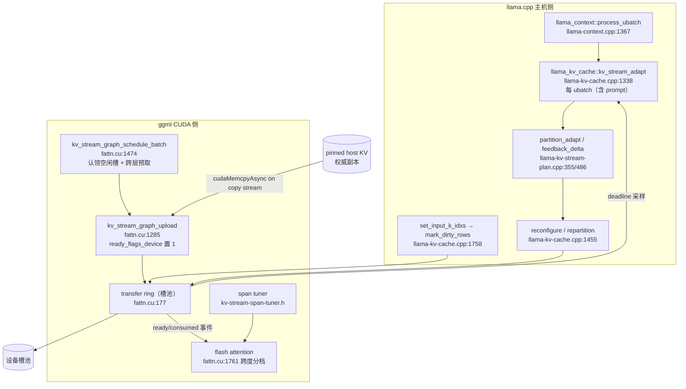
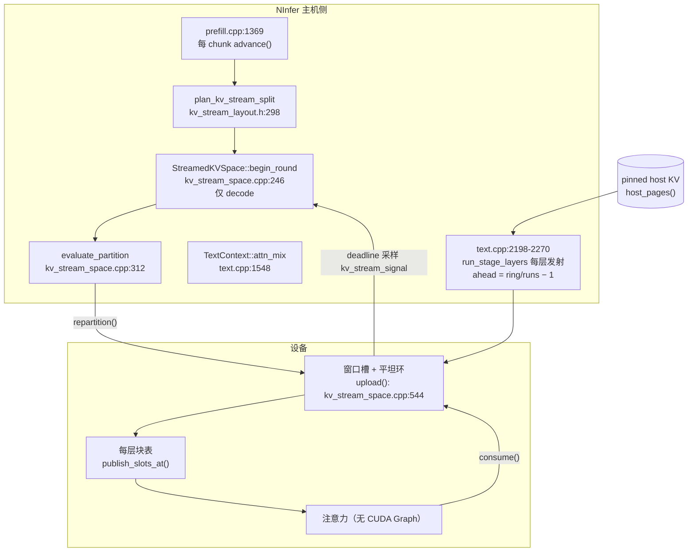

# KV 流式：总体战略与计划（唯一权威）

本文件是**计划的唯一权威**：指导思想、理论来源（逐条带行号）、NInfer 的特性与差异、数学验算与
初步预测、分期计划与验收。其它文档的分工：

| 文档 | 职责 |
|---|---|
| 本文件 | **为什么这样做、做到什么算完成**（战略、依据、验算、预测、分期） |
| [fidelity](kv-streaming-fidelity.md) | 上游机制 × 我方现状的逐条比对（§11 为 2026-11-10 全表面复核） |
| [worklog](kv-streaming-worklog.md) | 已经发生了什么：改动、缺陷账本、接手命令 |
| [measurements](kv-streaming-measurements.md) | 原始证据：时间、提交、命令、结果、作废数字表 |
| [inputs](adaptive-kv-streaming-inputs.md) | 作者文章原文（R1–R13）与 CUDA Graph 附录 |

上游代码在本机 `D:\GithubRepo\llama.cpp-adaptive-kv-streaming`（分支 `feature/adaptive-kv-stream`，
HEAD `4ba0b9b25`），与本仓库无构建依赖，只作为**事实来源**引用。

---

## 1 核心指导思想（五条，后续所有决定都回到这里）

1. **移植机制，不移植形状。** 作者解决的是"llama.cpp + 16 GB + Q8_0/Q4_0"，我们解决的是
   "NInfer + 16 GB + `rk4v4`/`rk8v4`"。形状（页大小、run 宽度、环深、跨度）必须在本机测出来；
   **机制**（主机权威、块表换页、槽位所有权、设备侧放行、每阶段适配、生产者依赖）必须原样吸收。
2. **测量决定形状，代码里不留"应该"。** 已有反例：环比 `1.10` 在 251 K 上错的概率很高、
   run 宽度不是杠杆、开图在旧记录里是 −3%。任何形状参数都要有本机样本，且样本随记录走
   （`stream.run_pages`、`stream.ring_runs` 已经在报告里）。
3. **逐位是正确性的唯一判据。** ids 相同不算；logprobs 逐位相同才算（M-16 的层号二次映射就是
   ids 全对、logprob 差 0.08 nat）。
4. **不许把"缩小范围"写成"别人的任务"。** SPEC 的"不在本次范围"必须逐条列出代价；交付条件
   对不上就写"未完成"，不写"基本完成"。
5. **先量后改。** 没有基线的东西不动代码；改动前后用同一 argv、同一构建比对。

---

## 2 理论来源（作者文章条目 → 上游实现行号）

作者文章原文见 [inputs](adaptive-kv-streaming-inputs.md)（R1–R13）；下表把它钉到上游代码上，
第三列是我们是否已有对应物（`✅` 有、`⚠️` 近似、`❌` 无，行号见 §4 的我方列）。

| 条目 | 上游实现（文件:行） | 机制要点 | 我方 |
|---|---|---|---|
| R1 主机权威、设备只放窗口 | `src/llama-kv-cache.cpp:236-320`（`kv_stream_runtime` 装配 `runtime_new`/`reconfigure`/`repartition`） | 权威在 pinned host，设备池是窗口+环 | ✅ |
| R2 块表间接寻址 | `src/llama-kv-cache.cpp:1758-1764`（`mark_dirty_rows_fn` 在写 KV 行时通报 CUDA 侧） | 换页只改表项，不改图拓扑 | ✅ |
| R3 平坦槽池 + 环 | `ggml/src/ggml-cuda/fattn.cu:177-231`（`ggml_cuda_kv_stream_transfer_ring`，`slot_request`/`ready`/`consumed`/`slot_used`） | 环是一池槽，任何层借用 | ✅ |
| R4 设备侧放行标志 | `fattn.cu:1298-1310`（`ready_flags_device` memset 后由拷贝流置 1） | 消费者在图内读标志，不在主机等 | ⚠️ 有标志（`core/kv_stream_signal.cu`），但不在图内 |
| R5 槽位所有权（消费后才可覆盖） | `fattn.cu:1290-1292`（`cudaStreamWaitEvent(copy_stream, consumed[slot])`） | 拷贝等读者消费 | ✅ |
| R6 跨度调优器 | `ggml/src/ggml-cuda/kv-stream-span-tuner.h:12-20`（`trial_samples=16`、`minimum_relative_gain=0.005`、`warmup_samples=1`） | 用端到端解码图计时选跨度 | ✅（`core/kv_stream_span_tuner.h:24-29`） |
| R7 分区控制器 | `src/llama-kv-stream-plan.cpp:355-485`（`partition_adapt`：迟滞、冷却、`target_ring_working_set_ratio`） | 边界按反馈移动，不按模型 | ✅（`core/kv_stream_partition.cpp`） |
| R8 **每 ubatch 适配（含 prompt）** | `src/llama-context.cpp:1381-1387`（`process_ubatch` 里调 `kv_stream_adapt`） | 不分阶段 | ❌ |
| R9 **prompt/decode 双布局与回退** | `src/llama-kv-cache.cpp:1386-1398`（`decode_layout_pages`，`A zero target restores prefill`） | prompt 用 uniform、decode 用 concentrated | ❌ |
| R10 **写路径脏行/镜像** | `fattn.cu:709-746`（`mark_dirty_rows`）、`fattn.cu:757-800`（`get_mirror`/`mark_mirrored`） | 只回写真的写过的页 | ❌ |
| R11 **图内调度（认领槽位 + 跨层预取 + 设备侧 deadline）** | `fattn.cu:1285-1345`（`graph_upload`）、`fattn.cu:1474-1520`（`graph_schedule_batch`）、`fattn.cu:1485-1486`（`deadline_sample`） | 整轮搬运在图内、工作守恒 | ❌ |
| R12 **prompt 时跨度=整层** | `fattn.cu:1761-1762`（`Q->ne[1] == 1 ? graph_decode_span_pages : UINT32_MAX`） | 一行分档 | ❌（行为近似靠"排除分帧"） |
| R13 规划器（驻留优先级、`pin_tail`、extent 迟滞） | `llama-kv-stream-plan.h:15-38`（region）、`:57-75`（extent）、`src/llama-kv-stream-plan.cpp:44`/`:169`/`:220` | 通用驻留分配 | ⏸ **上游运行时未接线** |

**R13 的诚实说明**：`llama_kv_stream_plan_make` / `regions_make` / `extent_make` /
`prefetch_dispatch`（`llama-kv-stream-plan.cpp:44/169/220/282`）在 `src/` 与 `ggml/` 里**除单测外零调用者**；
运行时真正用的是 `resident_cache_layout`（`fattn.cu:437`）+ `partition_adapt` + `feedback_delta`。
所以 R13 不构成"我们欠的移植"，但它的**机制思想**（生产者依赖、工作守恒填槽）在 R11 里是活的。

---

## 3 NInfer 的特性（必须保住，且应当被流式利用）

| 特性 | 位置 | 对流的含义 |
|---|---|---|
| 块表间接寻址 + 每层一张表 | `src/models/qwen3_5/program/storage/kv_stream_space.cpp:544-604`（`upload()` 每层**一次** `publish_slots_at`） | 换页只改表项；**这是能回到 CUDA Graph 的结构基础**（上游要在图内做同样的事，见 R11） |
| CUDA Graph（拓扑 + frontier 分档） | `src/models/qwen3_5/program/planning/startup.cpp:1510`（**流式时被关**）、`:1553` | 设计宣称"我们不必关图"，实现关掉了（C7） |
| 不变量注意力（`--invariant-attention`） | CLI `--invariant-attention`；decode/verify/prefill 同一 key 分段 | 让"跨布局逐位相同"成为可判定条件 |
| 三平面 INT8 家族页（64 token/页） | 报告 `stream.page_bytes`：`rk4v4` 71 680 B、`rk8v4` 104 448 B | 页只有上游的 1/4 大小 ⇒ 环/窗口的粒度更细，但 run 宽度要按字节折算 |
| MTP 草稿（3–4 token/轮） | `--spec mtp --draft-tokens 3`；MTP KV 在独立池、**整层驻留** | 每轮 3.96 token ⇒ 每轮字节被摊薄；MTP KV 不流式是容量损失（P5） |
| pinned host 权威副本 | `kv_stream_space.h:100-104`（`host_pages`） | 与上游一致 |
| 单卡、单序列、`--kv-capacity auto` 硬约束 | `startup.cpp:1357-1372` | 已知边界，不是缺口 |
| 可复现基准体系 | `tools/bench/run_kv_stream.py`（cases/golden/check/bench/report/compare） | 每个 P 的验收都在它上面跑 |

**我方与上游的结构差异（一句话）**：上游把"搬运"做成 CUDA 侧一个自带调度器的槽池（图内认领、
设备侧放行、跨层预取），主机只负责喂计划；我们把"搬运"留在主机侧（每层顺序发 run），控制器与
调优器在主机。前者能进图、能跨轮；后者简单、易验、但**无法重叠到图内**。

---

## 4 双侧差异表（机制 / 上游行号 / 我方行号 / 判定）

| 机制 | 上游 | 我方 | 判定 |
|---|---|---|---|
| 池切分（窗口+环） | `llama-kv-stream-plan.cpp:355`（控制器）、`fattn.cu:437`（`resident_cache_layout`） | `core/kv_stream_layout.h:198/254/298/334`（uniform/concentrated/split/resize） | ✅ 等价 |
| 环深（1.10） | `llama-kv-stream-plan.h:159`（`target_ring_working_set_ratio`） | `core/kv_stream_layout.h:70-73`（`kKVStreamRingRatio`）+ `:150`（`kv_stream_lookahead_ratio`） | ✅ 且我们多一条几何前视判据 |
| 控制器参数 | `llama-kv-stream-plan.h:160-170`（3/8 迟滞、64 冷却） | `core/kv_stream_partition.h:49-50`、`kv_stream_space.h:379-384`（试 4 轮、0.5% 回退、64 冷却） | ✅ 且多了"迁移是实验"一层 |
| 跨度调优 | `kv-stream-span-tuner.h:12-20`（16 样本、0.5%、warmup 1） | `core/kv_stream_span_tuner.h:24-29`（16 样本、0.5%）、四级阶梯 | ✅ |
| 每阶段适配 | `llama-context.cpp:1381` | `execution/text.cpp:2168-2169`（`begin_round` 带 `!prefill`） | ❌ |
| 双布局与回退 | `llama-kv-cache.cpp:1386-1398` | `kv_stream_space.cpp:407`（`entering_decode_layout = false` 硬编码） | ❌ 死分支 |
| 脏行/镜像 | `fattn.cu:709/757` | `kv_stream_space.cpp:798-826`（`advance` 无条件回写跌窗页） | ❌ |
| 图内调度 | `fattn.cu:1285/1474` | `execution/text.cpp:2198-2270`（主机每层发 run） | ❌ |
| 图 | 上游整轮在图内（`fattn.cu:1564-1720` 段） | `startup.cpp:1510`（流式关图，**父分支起如此**） | ❌（C7） |
| 跨轮预取 | 图内槽位认领天然跨轮 | 我方已删（`0c6927c7`；父分支 `text.cpp:2303` 是被删的那半） | ❌（C8） |
| 页大小 | 256 token/页 | 64 token/页 | 差异，非缺口 |
| KV 格式 | K/V 各自 ggml 量化（Q8_0/Q4_0） | `rk4v4`/`rk8v4` 三平面 INT8 家族 | 差异，非缺口 |

---

## 5 数学验算（符号先定义，再代入本机实测数）

符号：`L=16` 全注意力层；`P` 上下文页数（251 K ⇒ `P=⌈251000/64⌉=3922`）；`W_l` 层 `l` 的窗口页数；
`R` 环页数；`S` 池槽数（= `device_bytes/page_bytes`）；`page` 页字节；`BW` 链路带宽（实测 25.4 GB/s）；
`cp` 每 chunk 页数（`--prefill-chunk 256` ⇒ `cp=4`）。

### M1 容量（设计表与实测一致）

`rk4v4`：`page=71 680 B`、64 token ⇒ 1 120 B/token/层 ⇒ 262 144 token ⇒
`16 × 262 144 × 1 120 = 4.70 GB = 4.37 GiB`（设计表写"4.3 GB"实为 GiB）。
`rk8v4`：`page=104 448 B` ⇒ 1 632 B/token/层 ⇒ `16 × 262 144 × 1 632 = 6.85 GB = 6.38 GiB`（设计表 6.4 GiB ✓）。

### M2 池恒等式与环深（用实测几何反解，误差 <0.3%）

池被两层瓜分：`S = Σ_l W_l + R`；环按比例规划 `R = r · (P − W)`。
均匀时解出 `W = (S − rP)/(L − r)`，每轮字节 `bytes = L · (P − W) · page`。

- `rk4v4` 251 K 实测：`S=47 894`、`R=11×128=1408` ⇒ `r = 1408/(3922−2905) = 1.384`，
  反解 `W = (47894 − 1.384×3922)/(16−1.384) = 2905` ✓（实测 `resident_pages=2905`）。
  `bytes = 16 × 1017 × 71 680 = 1.1666 GB = 1112.9 MiB`，实测 1116.2 MiB ⇒ 偏差 0.3%。
- `rk8v4` 251 K：`S=31 583`、`R=20×128=2560` ⇒ 反解 `W=1816`（实测 1813）；
  `bytes = 3.81 GB = 3.55 GiB`，实测 3.367 GiB ⇒ 偏差 5%（⇒ 该布局不是纯均匀，见 M4 的 0.67 因子）。

### M3 251 K decode 的重叠上界（本机最重要的一条）

`rk4v4`：每轮 1116.2 MiB = 1.170 GB ⇒ 纯拷贝时间 `1.170/25.4 = 46.1 ms`；实测每轮 54.4 ms
（= 3.96 token ÷ 72.8 tok/s）。⇒ **拷贝占每轮 85%**；即使完全重叠，上界也只有 46.1 ms/轮
⇒ **≈ 85.9 tok/s**（现在是 72.8）。这就是 251 K 上"减小暴露"能拿到的全部空间，
再往上只能减字节（更大窗口 = 更多显存）或换更快的链路。

### M4 prefill 流量定律（两次实测同因子验证）

每 chunk 要把"活跃页 − 窗口"读完：`traffic ≈ page · Σ_l (P − W_l)²/(2·cp)`。

- `rk4v4` 251 K：`16 × 71 680 × 1017²/8 = 148 GB = 138 GiB`；实测 **94.1 GiB** ⇒ 因子 0.68。
- `rk8v4` 251 K：`16 × 104 448 × 2109²/8 = 929 GB = 865 GiB`；实测 **582.9 GiB** ⇒ 因子 0.67。

两个格式**因子相同**（0.68/0.67）⇒ 偏差不是格式相关，而是"窗口不是均匀的"（集中布局让多数层的
`W_l` 大于 `min`，平方项因此小于用 `W_min` 的估计）。**这一条也说明 prefill 流量的主导参数是窗口**：
`rk8v4` 的窗口 1813 vs `rk4v4` 的 2905 ⇒ `(2109/1017)² × (104448/71680) = 6.3`，实测比 `582.9/94.1 = 6.2` ✓。
结论：**decode 侧的控器决定窗口 ⇒ 悄悄决定 prefill 流量**；让 rk8v4 的窗口缩小 1 页，prefill 就要
多搬约 `2 · (P−W)/cp` 页（在 251 K 是每层每 chunk 约 1 050 页）。

### M5 prefill 的时间代价（同上下文 A/B，实测）

同一提示、同一构建、183 K：流式 **1476 tok/s** vs 全驻留 **1481 tok/s** ⇒ **0.3%**。
流式那次搬了 45.7 GiB、拷贝流忙 31.9 s，但**计算侧暴露 0.0 s** ⇒ 搬运完全被注意力掩盖。
⇒ **prefill 慢不是流式造成的**；"251 K 1281 vs 180 K 1593" 是上下文变长的 O(P²) 计算成本，
不能用它指责流式。（此前 worklog 里的对比口径是错的，已改。）

### M6 CUDA Graph 的收益上界（预测用）

每轮发射数 ≈ 层数 × 每层发射（2 个注意力 launch + 约 9 个 run 拷贝 + 表发布） ≈ 16 × 12 ≈ 190；
按每次 launch 2 µs 计 ≈ 0.38 ms = **每轮 0.7%**。而上游/旧记录的 −3% 说明图内节点调度本身有代价。
⇒ **预测：在 251 K 上开图不是杠杆**；它只在"每轮时间本来就短"的档位（≤64 K）可能有意义。

---

## 6 初步预测（全部可证伪，写在 P0–P6 的验收里）

| # | 预测 | 依据 | 证伪方式 |
|---|---|---|---|
| Y1 | 251 K `rk4v4` decode 的上界 ≈ 46 ms/轮（86 tok/s），且要把暴露压到 0 才能到 | M3 | P1/P3 后仍 >48 ms 即预测错 |
| Y2 | 251 K **开 CUDA Graph 不会超过 +1%**（很可能 −1…−3%） | M6 + 旧记录 −3% | P0 的 graph on/off 8 组样本 |
| Y3 | prefill 的分阶段适配能让 `rk8v4` 的 prefill 流量从 582.9 GiB 降到 ≤450 GiB（窗口由 prefill 需求决定而不是 decode 需求） | M4 | P2 后 `stream.prefill.upload_bytes` |
| Y4 | prefill 的**时间**几乎不会因流式而变（±1%），因为它被计算掩盖 | M5 | P1/P2 后同上下文 A/B |
| Y5 | 跨轮预取（P3）在 `r=2.0` 下能让 251 K 每轮下降 4–8%，代价是 +4% 字节 | M2 的 `bytes=C/(L−r)`：`r 1.38→2.0` ⇒ 字节 +4.3% | P3 后逐轮样本 |
| Y6 | `rk8v4` 的等价性可在 **110 K** 闭环（全驻留装得下），不必等更大显存的卡 | M1 在 110 K 的代入：`16 层 × 1719 页 × 104 448 B = 2.87 GB = 2.67 GiB`，加权重 11.6 GiB ⇒ 14.3 GiB，小于卡的 15.6 GiB 可用 | P6 录金标 + 同构建 resident/streamed 逐位 |

> Y6 的口径提醒：KV 总量 = 层数 × 页数每层 × 页字节；权重 11.6 GiB 单独加。

---

## 7 架构图

### 7.1 上游（作者）——搬运在 CUDA 侧、调度在图内

### 7.2 我方（现状）——搬运在主机侧、无图

**图上的差距一眼可见**：上游的主机只发计划、设备侧自调度、整轮在图内；我方主机逐层发 run、
每轮开始前才评估、且整体不在图内。

---

## 8 分期计划（P 系列；编号即契约，验收不达标不算完成）

顺序由依赖决定：**P0 是所有后续的入场券；P1/P2 修 prefill 的两处结构性缺失；P3 才谈重叠；
P4 由图决定；P5 是容量；P6 收官**。

| 期 | 内容 | 引用 | 验收（可驳回） |
|---|---|---|---|
| **P0** | 基线 + 可视化：graph on/off 各一组（183 K、251 K × `rk4v4`、`rk8v4`）；把布局形状（uniform/concentrated）、`entering_decode_layout`、repartition 次数、**每层窗口**写进报告 | M6、Y2、§11.2 #6 | 8 组逐轮样本落盘；报告能读出"这轮是什么布局、换过几次"；验证 Y2 |
| **P1** | prompt/decode 双布局 + 回退（prompt=uniform、decode=concentrated、下一 chunk 回退 uniform），布局代数进表发布与图缓存键 | R9（`kv-cache.cpp:1386`） | 251 K prefill 流量按 M4 下降且时间不差（验证 Y3/Y4）；decode 不退 |
| **P2** | 每 chunk 适配（prefill 也跑控制器与阶梯）+ 写路径脏行回写 | R8（`context.cpp:1381`）、R10（`fattn.cu:709`） | prefill 期出现 `[partition]` 决策；回写 ≤ 脏页量；251 K/183 K 逐位不变 |
| **P3** | 跨轮预取 + 槽位所有权：拷贝对"写该页的 attention"建生产者依赖，槽认领 + 设备侧 ready/consumed | R5/R11（`fattn.cu:1290/1474`） | `--kv-stream-ring-ratio 2.0` 下 183 K/251 K 逐位 PASS，每轮 ≥4% 下降（验证 Y5） |
| **P4** | CUDA Graph：按 P0 的 Y2 决定补图内换页还是维持关图（维持则必须写清理由与代价） | R11、C7 | 251 K `rk4v4` 不慢于 72.8 tok/s；graph vs eager logprobs 512/512 |
| **P5** | 草稿 KV（MTP/DFlash）作为独立驻留角色 | R13（上游未接线） | 同容量下池更大或每轮字节更少，逐位不破 |
| **P6** | 验证矩阵：262 144 prefill+decode × {`rk4v4`,`rk8v4`,`int8`} × resident(≤110 K)/streamed；活体迁移逐位；2000+ token 长跑；作者口径曲线（`benchmarks/benchmark_kv_stream.py` 的 8 K 步进 + 自动探池 + 可续跑 CSV） | 全部 | 每格 ids + logprobs 判据；SPEC 完成条件 1–5 逐条对账 |

### 8.1 明确不做（写下来，防止被当遗漏）

- 上游 R13 的 host 侧规划器 API（上游运行时未接线）。
- phase arena、图切分、多卡、图像 prefill 的分块流式（SPEC 已列"不在本次范围"；要做单独立项）。
- 降低 KV 精度换容量、UVM 路线（所有者已否决）。

### 8.2 本文件的更新纪律

每个 S 完成时：本文件对应行改成"已完成 + 实测数字 + 运行记录名"，并在
[measurements](kv-streaming-measurements.md) 追加一条；**预测被证伪时，把预测原样保留并标注
"证伪 + 实测"**，不删改历史。
